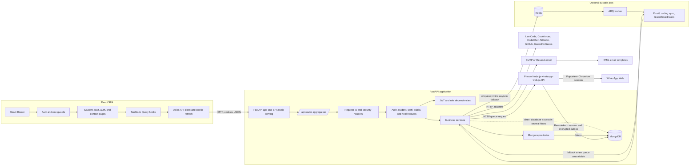
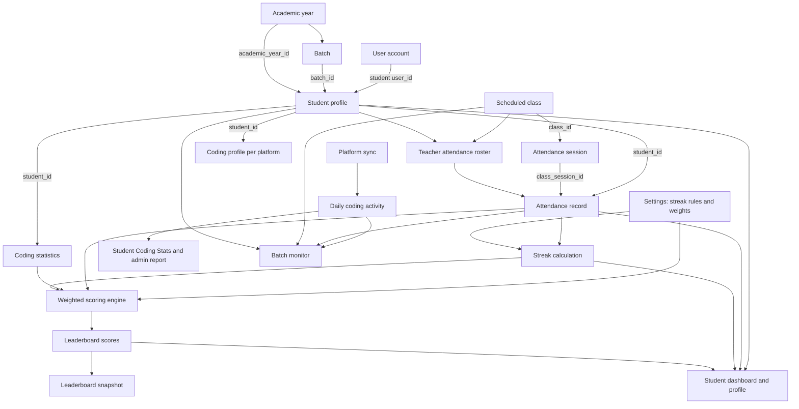
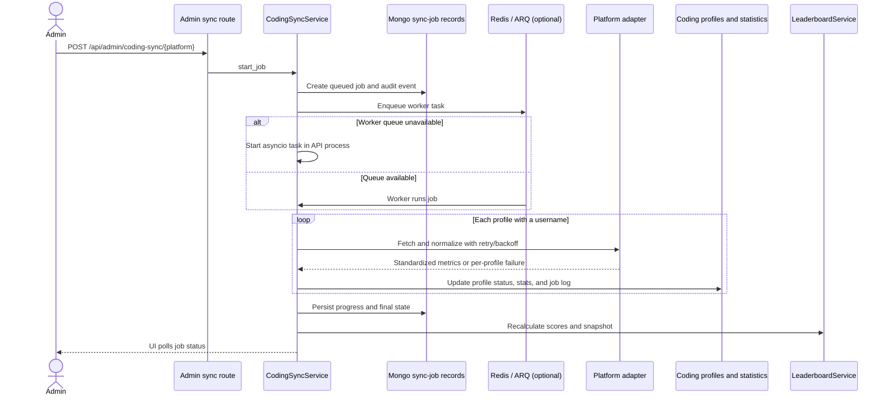
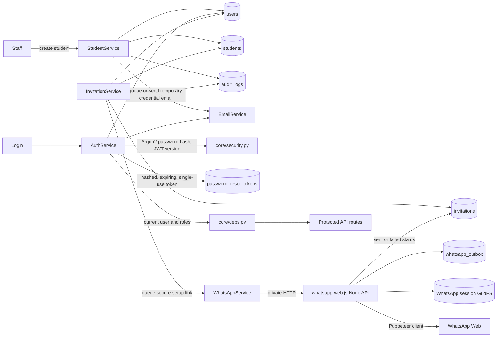

# LMS codebase knowledge graph

This graph is a structural snapshot generated on 2026-10-26. It links browser routes, API endpoints, services, repositories, MongoDB collections, background jobs, external systems, and tests. The accompanying [`knowledge-graph.json`](knowledge-graph.json) records **183 in-scope files, 444 nodes, and 1,548 edges**, including 73 API endpoints and 27 MongoDB collections. Its edges include statically derived imports, route registration, feature-to-hook use, test coverage links, and data-store access alongside the domain relationships below.

## System graph

The principal source for this graph is `backend/app/main.py`, which initializes the FastAPI lifespan and serves `frontend/dist` when it exists. `run.py` starts the app. In development Vite can serve the React application separately and proxy `/api` to FastAPI. MongoDB is the primary application store; Redis is used for durable jobs and distributed rate limiting, with in-process fallbacks in development. The WhatsApp client runs as a separate private Node service and persists its session and message outbox in MongoDB.

The invitation bulk-upload parser accepts CSV and XLSX files, validates and deduplicates recipient rows, and returns them for review before the existing bulk-send endpoint is called.

## Learning, attendance, and scoring graph

`backend/app/services/attendance_service.py` records one session for a class and upserts each student’s status against that session. `backend/app/services/streak_service.py` computes current and longest attendance runs from those records using settings; unscheduled dates are absent from its input. `backend/app/services/scoring_engine.py` normalizes attendance, coding, and streak scores, and `backend/app/services/leaderboard_service.py` persists per-student/per-platform scores and a snapshot. Student and staff pages read these server-produced results. Coding sync also stores dated, platform-specific activity in `coding_activity`; `CodingActivityService` serves the student Coding Stats page and admin student report. `BatchMonitorService` combines the current batch roster with saved class attendance and non-estimated coding activity for a selected date range, without inferring absences or changing records.

## Coding synchronization and jobs

The adapter registry in `backend/app/integrations/__init__.py` includes LeetCode, CodeChef, Codeforces, AtCoder, GitHub, GeeksForGeeks, HackerRank, and HackerEarth. GeeksForGeeks has an active adapter; HackerRank and HackerEarth intentionally raise `AdapterNotConfigured`. `CodingSyncService`’s `all` sweep includes GeeksForGeeks and omits HackerRank/HackerEarth. The frontend exposes platform metadata in `frontend/src/constants/codingPlatforms.ts`.

## Identity, invitation, and reset graph

Admin invitations create single-use, seven-day setup links and send them through the selected email and WhatsApp channels. WhatsApp messages are encrypted in a MongoDB outbox, sent one at a time, and update the invitation's delivery status; email status comes from the existing mail worker or direct SMTP send. The Invitations tab refreshes queued, sent, and failed states for both channels. Invite acceptance stores the password chosen by the student; direct admin-created accounts use a temporary password and forced-change flag. Reset tokens are stored hashed. Authorization is enforced by FastAPI dependencies; frontend route guards support navigation but do not authorize API requests.

## Repository and source inventory

The JSON graph includes a node for every in-scope source, test, configuration, template, and documentation file discovered in the repository, plus edges for local imports, feature-to-hook use, route registration, service/repository dependencies, test coverage links, and direct MongoDB collection access. The main architectural groupings are:

| Area | Key source paths | Responsibility |
|---|---|---|
| App and settings | `run.py`, `backend/app/main.py`, `backend/app/config.py` | Start the API, choose settings, serve the built SPA, and manage lifecycle |
| API boundary | `backend/app/api/router.py`, `backend/app/api/v1/` | Public contact and health endpoints; auth and student endpoints; admin/staff endpoints for students, invitations, imports, classes, batches, analytics, reports, coding sync, settings, and audit logs |
| Identity and safety | `backend/app/core/`, `backend/app/middleware/` | Password/token handling, role checks, throttling, structured secret-scrubbed logs, errors, request IDs, and security headers |
| Business logic | `backend/app/services/` | Account lifecycle, attendance, streaks, scoring, leaderboards, coding sync and daily activity, batch monitoring, settings, analytics, reports, imports, invitations, auditing, email, and WhatsApp |
| Data access | `backend/app/repositories/`, `backend/app/database/`, `backend/app/models/`, `backend/app/schemas/` | MongoDB queries and indexes, optional Redis queue/heartbeat, shared enums, and request/response models |
| Integrations and worker | `backend/app/integrations/`, `backend/app/workers/`, `backend/app/templates/email/` | External coding-platform adapters, ARQ task definitions, and email templates |
| WhatsApp service | `backend/app/services/whatsapp_service.py`, `whatsapp-api/`, `render.yaml` | Authenticated private HTTP API, encrypted MongoDB outbox, WhatsApp Web session, and Render private service |
| Frontend | `frontend/src/routes.tsx`, `features/`, `api/`, `context/`, `layouts/`, `components/`, `types/` | Role-aware SPA routes and pages, API/query layer, session state, shared UI, and domain types |
| Operations | `Dockerfile`, `render.yaml`, `backend/requirements*.txt`, `backend/pytest.ini`, frontend manifests and configs | Build, deploy, and dependency configuration |
| Tests | `backend/tests/` | Authentication, security, imports, platform adapters, streaks, scoring, reports, and logging behavior using a mock Mongo client where applicable |

## MongoDB collection nodes

`backend/app/database/mongo.py` is the index catalog. Collection usage is derived from code, including direct collection access in handlers/services as well as repository-backed access.

| Collection | Main graph links |
|---|---|
| `users` | Login identity and role; student profile’s `user_id`; audit actor; job requester |
| `students` | User, batch, academic year; source for attendance, coding profiles, analytics, and leaderboards |
| `academic_years` | Student/class academic year references; ensured during import |
| `batches` | Student/class membership; batch assignment and roster queries |
| `classes` | Schedules; attendance-session parent; class filtering and analytics |
| `attendance_sessions` | One session per class; parent of per-student attendance records |
| `attendance_records` | Links a student to a class session; input for attendance, heatmaps, streaks, reports, and score calculation |
| `coding_profiles` | Student/platform username and sync state; input to adapter jobs and coding-profile UI |
| `coding_statistics` | Normalized platform metrics for student scoring and reports |
| `coding_activity` | Dated per-student/per-platform metric history used by activity charts, leaderboards, and batch monitoring |
| `coding_sync_jobs` | Requested platform, requester, progress, and final job state |
| `coding_sync_logs` | Per-student outcome linked to a sync job |
| `leaderboard_scores` | Precomputed per-student overall/platform scores and ranks |
| `leaderboard_snapshots` | Timestamped leaderboard snapshots |
| `streaks` | Declared index/materialized-cache collection; current app paths compute streaks from attendance records |
| `settings` | Application thresholds, scoring weights, streak rules, and sync tuning |
| `settings_history` | Settings change history written by `SettingsRepository` |
| `audit_logs` | Actor/action/entity and scrubbed before/after audit data |
| `password_reset_tokens` | Hashed single-use password reset tokens with an expiry index |
| `invitations` | Hashed invite token, recipient, WhatsApp delivery status, role, use state, and expiry |
| `whatsapp_outbox` | Encrypted WhatsApp invitation messages waiting for sequential delivery |
| `whatsapp_sessions.files`, `whatsapp_sessions.chunks` | Linked-device session archive stored through MongoDB GridFS |
| `import_previews` | Validated XLSX rows awaiting confirmation |
| `email_logs` | Email delivery status and failure details |
| `contact_messages` | Public contact form submissions |
| `notifications` | Declared collection/index for an in-app notification path not currently exposed by a feature route |

Important reference fields visible in the queries and writes include `students.user_id`, `students.batch_id`, `students.academic_year_id`, `classes.batch_id`, `classes.academic_year_id`, `attendance_sessions.class_id`, `attendance_records.student_id`, `attendance_records.class_session_id`, coding records’ `student_id`, and sync logs’ `job_id`. Several IDs are stored as strings in service writes while other paths query them as BSON ObjectIds; see the source for conversion points.

## UI routes and API groups

`frontend/src/routes.tsx` organizes the student portal under a STUDENT role guard and the admin portal under SUPER_ADMIN, ADMIN, or TEACHER. Auth, invitation acceptance, contact, and password flows have their own public/authenticated routes. API route definitions are captured individually in `knowledge-graph.json`, with the `/api` prefix applied.

| UI area | Pages | Backend/API group |
|---|---|---|
| Auth | Login, forgot/reset password, invitation acceptance, forced password change | `/api/auth/*` |
| Public | Contact | `/api/contact` |
| Student | Dashboard, leaderboard, Coding Stats, profile | `/api/student/*` |
| Admin/staff | Dashboard, students, individual report, invitations, classes, attendance, coding profiles, leaderboards, analytics, reports, batches and batch monitor, settings, audit logs, sandbox | `/api/admin/*` |
| Health | No user page | `/api/health`, `/api/ready` |

## Tests connected to the graph

| Test file | Main subject |
|---|---|
| `backend/tests/test_attendance_roster.py` | Attendance roster and saved statuses |
| `backend/tests/test_batch_monitor.py` | Batch monitor date ranges, active roster, attendance and coding activity |
| `backend/tests/test_health_queue.py` | Health and queue readiness |
| `backend/tests/test_leaderboard.py` | Leaderboard metrics and activity history |
| `backend/tests/test_auth_flows.py` | Login, user creation, password reset/token use, logout invalidation, forced password change |
| `backend/tests/test_security.py` | Password hashes, temporary passwords, JWT claims/expiry, opaque token hashes |
| `backend/tests/test_streaks.py` | Attendance statuses, configurable streak rules, no-class days |
| `backend/tests/test_scoring.py` | Metric normalization and configurable aggregate scoring |
| `backend/tests/test_adapters.py` | Adapter normalization, adapter failures, unsupported platform behavior |
| `backend/tests/test_import.py` | Workbook parsing, row validation, duplicates, DB conflicts |
| `backend/tests/test_student_report.py` | Student report construction and output formats |
| `backend/tests/test_logging_scrub.py` | Secret scrubbing in structured and embedded log values |
| `backend/tests/conftest.py` | Mock Mongo client and shared test fixtures |

## Verified implementation details

1. Spreadsheet import hooks call `/admin/imports/preview` and `/admin/imports/confirm`, matching the backend handlers. Import previews expire after 15 minutes; confirmation checks expiry and MongoDB also has a TTL index.
2. The architecture guide describes repositories as the only code that talks to MongoDB. Several API handlers and services also query MongoDB directly; the graph marks those direct data links.
3. GeeksForGeeks uses an undocumented public profile endpoint and is included in the all-platform sync. HackerRank and HackerEarth are registered for profile metadata but their adapters are not configured and the all-platform sweep skips them.
4. Batch monitoring reports the current batch membership for a selected date range. Attendance percentages use saved statuses; pending classes and unmarked records remain separate, and estimated coding activity is excluded.

## Scope and method

The graph covers first-party application source, tests, templates, configuration, dependency manifests, and project documentation. It leaves out `.env`, virtual environments, dependency install trees, Git internals, Python caches, generated frontend build output, source maps, and binary/media assets. Python and TypeScript import edges, FastAPI route definitions, React route/page links, query-hook usage, test imports, and database-collection access links are extracted from source. Domain references and runtime job flow are documented from the associated write/query code and service calls. Names and import links are static evidence; they do not assert that an optional external service is configured or reachable.

In the JSON, each node has an `id`, `type`, and `label`; source nodes also carry a repository-relative `path`. Each edge has `source`, `target`, `relation`, and, where available, `evidence` and `detail`. Route and hook links are structural links inferred from their source declarations; they do not represent runtime request results.
